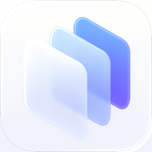
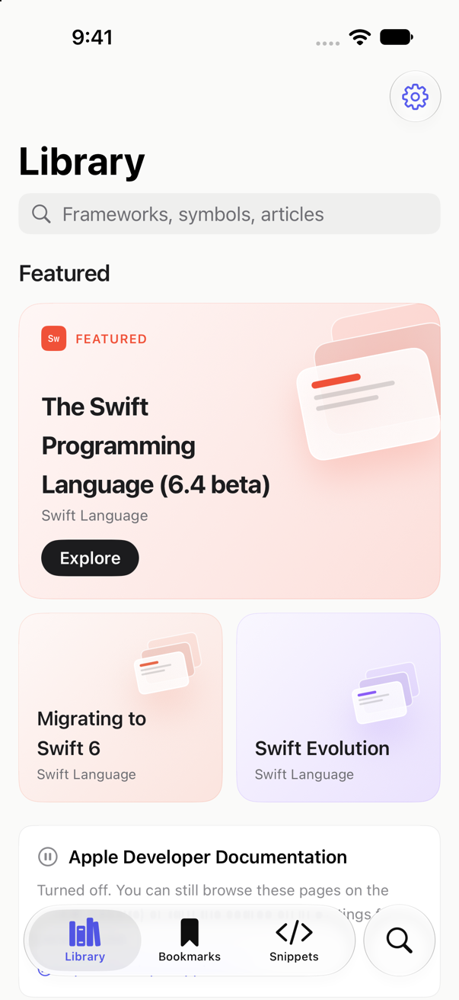
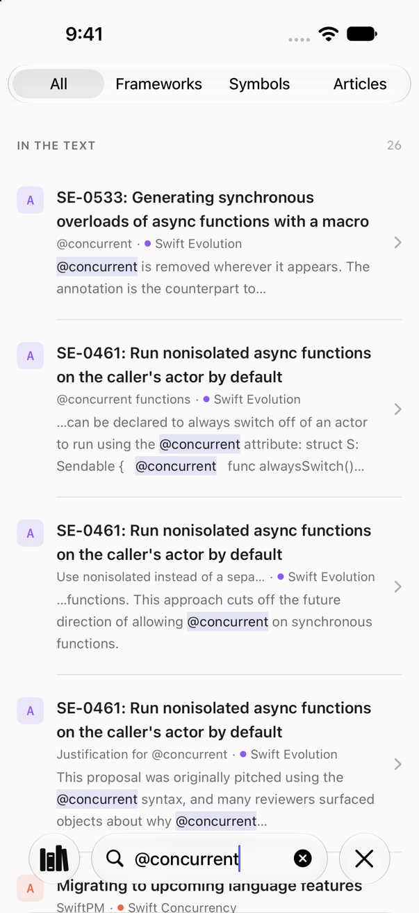
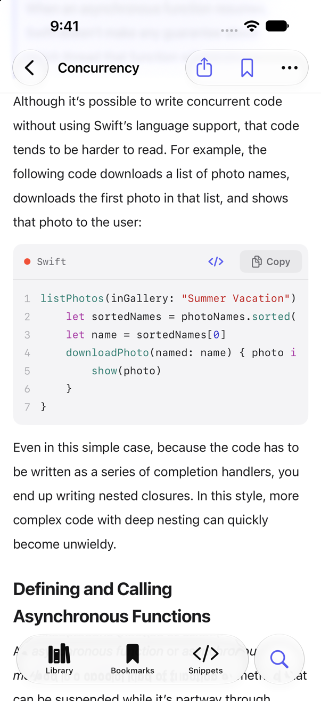
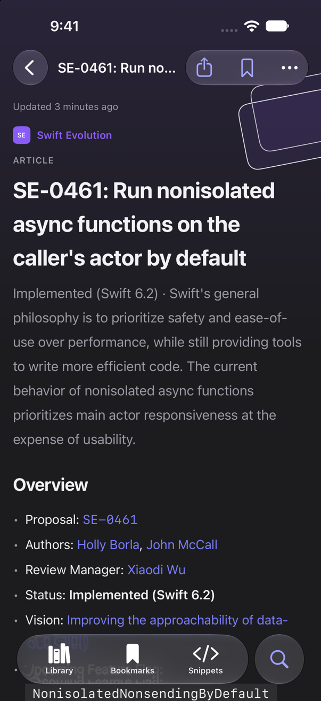
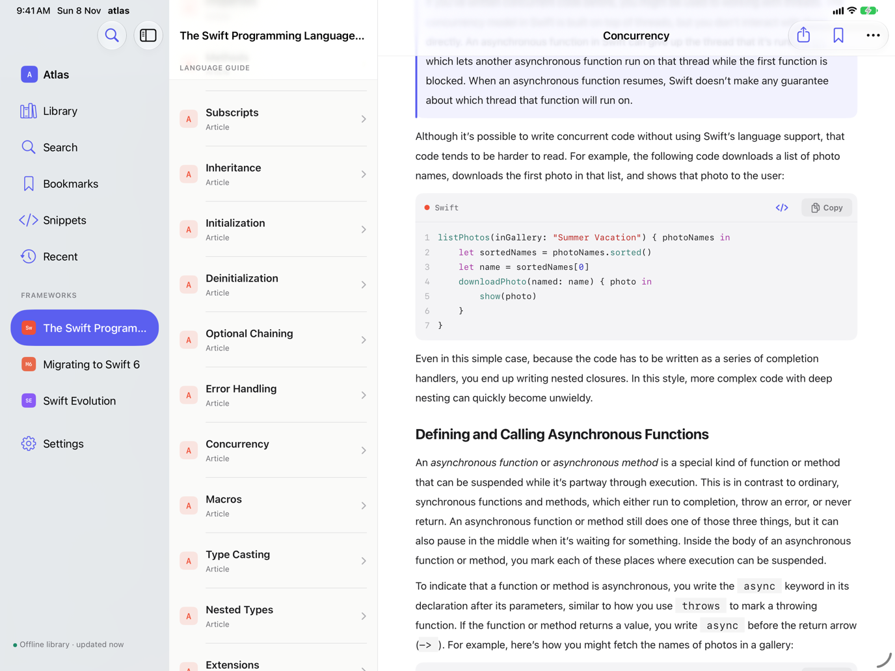
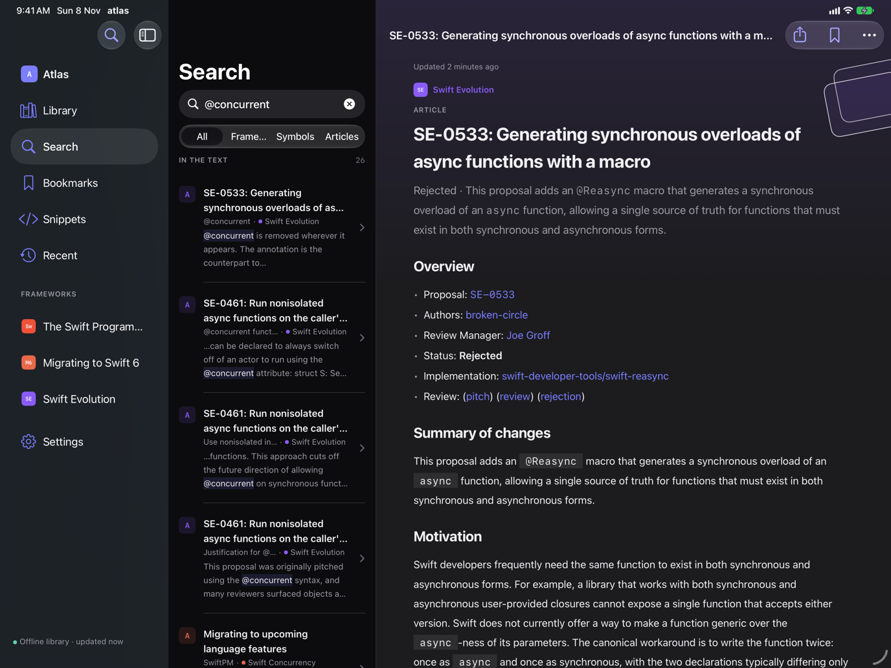

<p align="center">
  
</p>

<h1 align="center">Atlas</h1>

<p align="center">A native documentation companion for Swift and Apple-platform developers, for iPhone, iPad and Mac.</p>

<p align="center">
  <a href="https://github.com/CarolaneLFBV/atlas/actions/workflows/tests.yml"></a>
</p>

Atlas is a Swift and Swift Evolution reader. It brings The Swift Programming Language, the Swift 6 migration
guide and every Swift Evolution proposal into a fast, offline-first app with full-text search, bookmarks and code
snippets. Apple Developer Documentation is optional and off by default, for personal use.

<p align="center">
  
  
  
  
</p>

<p align="center">
  
  
</p>

<p align="center"><sub>Screenshots of the app's real content (iOS 27.2 simulators), with the Apple source off.</sub></p>

## Features

- **Read offline.** Openly licensed guides are downloaded once and rendered natively, with syntax-highlighted,
  copyable code.
- **Search everything you've seen.** Titles, symbols and keywords, plus the full text of downloaded guides
  (`@concurrent` finds SE-0461 and the passages that use it). Deprecated APIs are marked and ranked lower.
- **Keep what matters.** Bookmarks grouped by framework, personal code snippets, and your reading history.
- **Choose your sources.** Turn sources and Library sections on or off in Settings.
- **Built for every screen.** Tabs on iPhone, a three-column layout on iPad and Mac.

## Documentation sources and licensing

| Source | Status | License |
|---|---|---|
| The Swift Programming Language | On by default | Apache 2.0 |
| Swift 6 Concurrency Migration Guide | On by default | Apache 2.0 |
| Swift Evolution | On by default | Apache 2.0 |
| Apple Developer Documentation | **Off by default** | Not licensed for redistribution |

Apple's Website Terms of Use don't permit reproducing developer.apple.com content or accessing it automatically
without permission. Atlas therefore never contacts developer.apple.com unless you turn it on in Settings, for your
own personal use; it never bulk-downloads Apple pages. See [docs/DocumentationSources.md](docs/DocumentationSources.md).

### Turning on Apple Developer Documentation

In **Settings → Apple Developer Documentation**, turn on **Load Apple Pages in Atlas**. Then:

- The catalogue and each page are loaded only when you open them, with attribution and a link to developer.apple.com.
- Opening a framework makes its whole API searchable by name (one request per framework, rechecked weekly).
- Apple pages are never downloaded in bulk or full-text indexed. Turn the setting off and developer.apple.com is
  no longer contacted at all.

No documentation is stored in this repository: content is downloaded and cached on the device.

## Requirements

- Xcode 27 or later
- iOS 26, iPadOS 26 or macOS 26 or later

## Building

1. Clone the repository and open `atlas.xcodeproj`.
2. In the `atlas` target, under **Signing & Capabilities**, choose your own team and, if needed, change the bundle
   identifier (`com.example.atlas`) to one you own. Please don't commit these changes.
3. Select the `atlas` scheme and run.

Run the unit tests with the `atlasTests` scheme (⌘U). They use in-memory stores and a fake HTTP client, so they
never touch the network.

## Project structure

Atlas follows Clean Architecture with MVVM, SwiftUI, SwiftData and Swift Testing, in Swift 6 language mode.

```
atlas/
├── App/            Composition root, launch, navigation
├── Domain/         Entities, repository protocols, use cases (Foundation only)
├── Data/           Networking, DocC and Markdown parsing, cache, SQLite search, persistence
├── DesignSystem/   Tokens and reusable components
└── Presentation/   Screens and their view models
atlasTests/         Unit tests, mirroring the source tree
```

[ARCHITECTURE.md](ARCHITECTURE.md) explains the layers, conventions, concurrency, search storage and stored formats.

## Contributing

Contributions are welcome. Please read [CONTRIBUTING.md](CONTRIBUTING.md) first.

## License

Atlas is available under the [Apache License 2.0](LICENSE). See [NOTICE](NOTICE) for attributions.

Apple, Swift and other Apple product names are trademarks of Apple Inc. Atlas is not affiliated with or endorsed by
Apple Inc.
